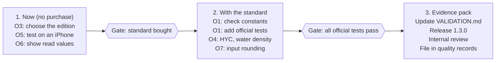

# Proposal: closing the open items of the Avjet fuel conversion tool

2026-11-16 · Status: draft, waiting for decisions

## Summary

We ask for approval to buy the official standard and to spend a short block of work to close the
six open items of the Avjet fuel conversion tool. Today the tool follows ASTM D1250-08 / API MPMS
11.1-2004, but its constants come from public sources and memory, not from the standard itself.
Without the official text and its test values, we cannot prove to an auditor that the tool gives
the same results as the standard.

The tool is used only to compare fuel data with laboratory certificates of analysis. It is not
used for sales or invoicing, so the risk today is low. The work below turns "probably right" into
"shown to be right, with evidence".

The method, the source of every constant and the open items are recorded in
[VALIDATION.md](VALIDATION.md) (version 1.2.0).

## Open items today

O1 is the only item an auditor would see as a real gap; the others are small. O2 was closed in
version 1.2.0.

| ID | Open item | Audit risk | Needs the standard? |
| --- | --- | --- | --- |
| O1 | Constants and method not checked against the official standard; no official test values in the tests | High | Yes |
| O4 | Glass hydrometer correction and water density at 60 °F not confirmed | Medium | Yes |
| O7 | Inputs (density, temperature) are not rounded before the calculation; the standard may require it | Medium | Yes |
| O3 | Edition: D1250-08 was chosen, but newer ASTM editions and API addenda exist | Medium | No, a decision |
| O5 | Web app not tested on a real iPhone | Low | No |
| O6 | `10,000` typed with a thousands separator is read as 10 | Low | No |

## Proposed work

Each item ends with a recorded result in [VALIDATION.md](VALIDATION.md), so the auditor sees the
evidence, not just the claim. Owners are roles; names to be set.

| ID | Action | Owner | Done when |
| --- | --- | --- | --- |
| O1 | Buy ASTM D1250-08 with API MPMS 11.1-2004 (ideally with the API's official test data or reference code). Check every constant and step in VALIDATION section 2.1 against the text. Add at least 20 official test points per product group (80+ in total) as exact tests. | Quality manager (buys); developer (tests) | Every row of section 2.1 says "Confirmed" with document, page and table; all official points pass (VCF ±0.000005, density ±0.05 kg/m³) in both the Android and web tests |
| O4 | Find the hydrometer correction and the 60 °F water density in the standard; correct the code if they differ | Developer | Both values cited with page; tests updated |
| O7 | Read the standard's rounding rules for the 15 °C procedures; apply them to inputs if required | Developer | Rule cited; official points still pass after the change |
| O3 | Confirm which edition our procedures and our laboratories' certificates use (D1250-08 or a later one) | Quality manager | Decision written in VALIDATION section 2, with date and name |
| O5 | Install the web app on an iPhone; test keypad (dot and comma), offline use, English and French | Any staff member with an iPhone | Result and date added to VALIDATION section 6.4 |
| O6 | Show under each box how the number was read (for example "read as 10 L"), and warn in English mode when a comma is followed by exactly three digits (`10,000`). Do not refuse it: in French `0,800` is a valid density. | Developer | New tests pass in both apps; behaviour noted in README |

## Order of work

Phase 1 can start today; phase 2 waits for the standard. There are no dates yet, because they
depend on when the standard arrives.

Phase 3 starts only when every official test point passes in both the Android and the web code.

## Resources and costs

The only purchase is the standard; everything else is staff time. Prices were not looked up and
need a quote.

| Item | What | Estimate |
| --- | --- | --- |
| Standard | API MPMS Chapter 11.1-2004 with ASTM D1250-08 (from API or ASTM). Ask whether the official test data or reference code is included | Quote needed |
| Developer time | O1 check and official tests, O4, O7, O6, docs and release | About 3 to 4 days, if the official test data comes in a usable form |
| Quality manager time | O3 decision, buying, final review | About half a day |
| iPhone test (O5) | One person, one iPhone | About 1 hour |
| Optional: lab cross-check | Ask our laboratory for 10 recent samples with the raw reading (observed density and temperature) and the density at 15 °C on the certificate; compare with the tool | About 2 hours, no cost |

The time estimates are rough and assume no surprises when the constants are checked. If the
standard shows a constant is wrong, the fix is small, but every test point must be checked again.

## Decisions needed

Three decisions unblock the plan; the first one starts phase 2.

- [ ] Approve the purchase of API MPMS 11.1-2004 / ASTM D1250-08, after a quote.
- [ ] Confirm the edition (O3): D1250-08, or the edition our laboratories use on their
      certificates, if newer.
- [ ] Name the owners: a quality manager for O3 and the final review, a developer for the code,
      one person with an iPhone for O5.

Until phase 3 ends, the tool keeps its on-screen note: for comparison with laboratory certificates
only, not yet checked against the official test data.

## Result: the evidence pack

At the end, an auditor gets one place to look, the repository, with:

- [VALIDATION.md](VALIDATION.md) with every constant marked "Confirmed" and its page in the standard.
- 80 or more official test points that pass in both the Android and the web code, run on every
  change by GitHub Actions.
- The edition decision (O3), signed and dated.
- A tagged release (1.3.0) with its signed APK, and the change history in
  [CHANGELOG.md](../CHANGELOG.md).
- Optional: the lab cross-check results from 10 recent samples.
